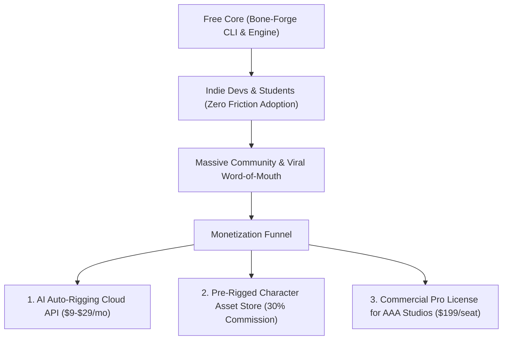

# Bone-Forge Business & Monetization Blueprint

How to provide **100% Free Software to Students & Indie Devs** while building a **High-Margin, Highly Profitable Business**.

---

## 1. The 3 Revenue Streams

### Stream A: AI Auto-Rigging Cloud Service (SaaS / Micro-credits)
- **Problem**: Manual bone placement and weight painting takes 2–4 hours per character.
- **Solution**: User uploads a 2D PNG sprite. The cloud AI service:
  1. Detects body contour and segments joints (head, torso, limbs).
  2. Auto-places the optimal bone hierarchy.
  3. Paints smooth vertex weights.
- **Pricing**:
  - 3 Free auto-rigs per month for everyone.
  - **Indie Plan**: $9/month for 50 auto-rigged characters.
  - **Studio Plan**: $49/month for unlimited auto-rigs + batch processing.

### Stream B: Rigged Asset Store & Templates (Marketplace)
- Create a marketplace where artists sell pre-rigged characters (monsters, bosses, anime avatars, platformer heroes).
- Bone-Forge takes a **20–30% platform fee** on every asset sold (similar to Unity Asset Store or Unreal Marketplace).

### Stream C: Commercial Studio License (Dual-Licensing)
- Bone-Forge core is Apache 2.0 / open-source.
- For game studios requiring:
  - Custom game engine export plugins (Unreal C++, proprietary custom engines).
  - Priority SLA & enterprise support.
  - Dedicated training and custom IK solver integration.
- Price: **$199 / seat per year** (still half the price of Spine Pro).

---

## 2. Why this Works
1. **Zero Customer Acquisition Cost (CAC)**: Because the core is free and open-source, indie developers recommend it on Reddit (r/gamedev), Twitter/X, and YouTube.
2. **High Conversion to Convenience**: Busy solo developers will happily pay $9 to save 10 hours of manual bone weighting.
